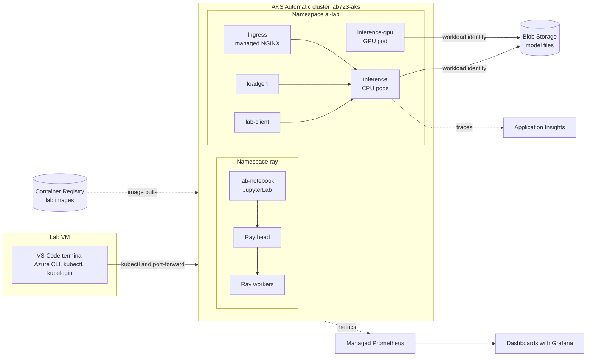

# The lab environment

The hosted lab gives each attendee an isolated environment that's ready before the lab starts, so the 75 minutes go to the exercises instead of setup. This page describes that environment. Use it to understand what's already running when you start, or to build a similar environment in your own Azure subscription.

## Architecture

Requests flow from the `lab-client` and `loadgen` pods, and through the ingress, to the inference service in the `ai-lab` namespace. The inference pods read the model from Azure Blob Storage by using workload identity, so no secrets are stored in the cluster. Managed Prometheus collects platform and application metrics, which dashboards with Grafana display in the Azure portal. The Ray cluster in the `ray` namespace shares the same cluster and the same capacity, which node autoprovisioning (NAP) manages.



## Azure resources

Everything is in the lab's resource group. The `<suffix>` keeps each lab's registry and storage account names unique.

| Resource | Name | Configuration |
| --- | --- | --- |
| AKS Automatic cluster | `lab723-aks` | Kubernetes 1.36, with the AKS Automatic defaults: Microsoft Entra ID with Azure RBAC for Kubernetes authorization, workload identity, deployment safeguards in **Enforce** mode, and node autoprovisioning. Also the application routing add-on with managed NGINX and an external controller, Managed Prometheus, and Container insights. |
| Container registry | `lab723acr<suffix>`, Standard tier | The lab's six images, with version tags: `lab723/inference`, `lab723/inference-gpu`, `lab723/lab-client`, `lab723/loadgen`, `lab723/ray`, and `lab723/notebook`, each tagged `1.0.0` |
| Storage account | `lab723st<suffix>` | A private `models` container with the model files |
| User-assigned managed identity | `lab723-inference` | A federated credential for `system:serviceaccount:ai-lab:inference`, issued by the cluster's OIDC issuer |
| Log Analytics workspace | `lab723-logs` | Container insights logs |
| Azure Monitor workspace | `lab723-prometheus` | Managed Prometheus metrics, with the data collection rules, and the node, Kubernetes, and UX recording rules that the portal's Kubernetes views use |
| Application Insights | `lab723-appinsights` | Workspace-based. Receives the inference service's OpenTelemetry traces. |
| Dashboard with Grafana | `LAB723-AI-inference` | Request rate, p50 and p95 latency, CPU use compared with limits, CPU throttling, replicas, nodes, and GPU utilization |

## Roles

AKS Automatic uses Azure RBAC for Kubernetes authorization, and the Owner and Contributor roles don't grant access to the Kubernetes API or to Prometheus data. So the lab assigns these roles explicitly.

| Identity | Roles |
| --- | --- |
| You, the lab user | Azure Kubernetes Service RBAC Cluster Admin on the cluster, Monitoring Data Reader on the Azure Monitor workspace, and Log Analytics Reader on the Log Analytics workspace |
| The cluster's kubelet identity | AcrPull on the container registry |
| The `lab723-inference` managed identity | Storage Blob Data Reader on the `models` container |

## Cluster configuration

| Setting | Value |
| --- | --- |
| `default` NodePool | The AKS default general-purpose VM sizes, with `consolidationPolicy: WhenEmpty` and `consolidateAfter: 30s`, so that NAP doesn't move lab pods during an exercise |
| `gpu` NodePool | Only `Standard_NC4as_T4_v3` (4 vCPUs and one NVIDIA T4 GPU), on-demand capacity, a `nvidia.com/gpu` taint with the `NoSchedule` effect, a `cpu` limit of `8`, which allows two GPU nodes, and `WhenEmpty` consolidation after 30 seconds. No GPU node exists when the lab starts. |
| `gpu` AKSNodeClass | The `EnableManagedGPUExperience: "true"` tag, so that AKS installs the NVIDIA driver, device plugin, and DCGM exporter on each GPU node. AKS-managed GPU nodes need the `ManagedGPUExperiencePreview` preview feature of the `Microsoft.ContainerService` resource provider. |
| Spare capacity | 3.5 to 5 CPUs that no pod has requested, on the CPU nodes, with 2 CPUs and 4 GiB free on one node. Exercises 2 and 3 then never wait for a node, and the scale-out in Exercise 4 always needs one, so you can watch NAP add it. |
| Autoscalers | The Horizontal Pod Autoscaler, KEDA, and the Vertical Pod Autoscaler, which AKS Automatic enables. No VPA object targets the inference workload. |
| Pod Security Standards | Baseline |

## Kubernetes objects when the lab starts

| Object | Namespace | Details |
| --- | --- | --- |
| ServiceAccount `inference` | `ai-lab` | The `azure.workload.identity/client-id` and `azure.workload.identity/tenant-id` annotations for the `lab723-inference` identity |
| ConfigMap `lab-environment` | `ai-lab` | `REGISTRY`, `MODEL_STORAGE_ACCOUNT`, `MODEL_ACCOUNT_URL`, and `MODEL_CONTAINER`, which the inference manifests read |
| Secret `appinsights` | `ai-lab` | `APPLICATIONINSIGHTS_CONNECTION_STRING` |
| Deployment `lab-client` | `ai-lab` | One replica of the `lab-client` image, which runs `sleep infinity`, with 500m CPU and 512Mi of memory. The exercises run its `predict` and `bench` commands with `kubectl exec`. |
| Deployment `loadgen` | `ai-lab` | Zero replicas of the `loadgen` image, with `TARGET_URL` set to `http://inference.ai-lab.svc.cluster.local`, and 500m CPU and 256Mi of memory for each replica |
| ServiceMonitor `lab723-inference` | `ai-lab` | In the `azmonitoring.coreos.com/v1` API group, which Managed Prometheus reads. Scrapes `/metrics` every 30 seconds on the port named `http` of the Services labeled `app: inference` or `app: inference-gpu`. |
| KubeRay operator | `kuberay-system` | The `kuberay-operator` Helm chart, version 1.7.1 |
| RayCluster `ray-lab` | `ray` | Ray 2.59.0 with the `ray` image: a head with 1 CPU and 4Gi of memory, and two workers with 1 CPU and 3Gi each, with autoscaling off. The head Service, `ray-lab-head-svc`, serves the Ray dashboard on port 8265 and Ray clients on port 10001. |
| Deployment and Service `lab-notebook` | `ray` | JupyterLab on port 8888, from the `notebook` image, with `RAY_ADDRESS` set to `ray://ray-lab-head-svc.ray.svc.cluster.local:10001`. Reachable only through `kubectl port-forward`. |

The `lab-client`, Ray, and notebook pods have the `karpenter.sh/do-not-disrupt: "true"` annotation, so that NAP doesn't move them during the lab.

The exercises create everything else: the `inference` Deployment, Service, and Ingress, the `guardrail-demo` Deployment, the `inference-gpu` Deployment and Service, the Horizontal Pod Autoscaler, and the GPU node.

## Lab VM

A Windows 11 VM with Visual Studio Code, Microsoft Edge, the Azure CLI, `kubectl`, and `kubelogin`. The kubeconfig uses kubelogin's `azurecli` mode, so `kubectl` uses your `az login`. VS Code opens `C:\LabFiles\LAB723`, which has the lab files from the `labfiles` folder of the [ai-lab repository](https://aka.ms/ignite26-ai-lab), with the lab's registry and other names in place of the placeholders in angle brackets.

## The sample app and model

The inference service classifies English text as POSITIVE or NEGATIVE with [DistilBERT base uncased, fine-tuned on SST-2](https://huggingface.co/distilbert/distilbert-base-uncased-finetuned-sst-2-english), an Apache-2.0 model, exported to ONNX and run with ONNX Runtime behind FastAPI. It loads the model from Blob Storage with workload identity, reports its own latency, serves Prometheus metrics at `/metrics`, and sends OpenTelemetry traces to Application Insights. The same model runs on the Ray workers for the batch job in Exercise 5.

The [ai-lab repository](https://aka.ms/ignite26-ai-lab) has the app's source, the Dockerfiles for the six images, the lab files, the Ray notebook, the dashboard, and the model's pinned download list. Its workflow publishes the images as `ghcr.io/bbenz/lab723/<name>:1.0.0`.

## Run the exercises on your own

The hosted lab's setup automation is specific to the lab platform, so it isn't published. To run the exercises in your own Azure subscription, build an environment that matches the tables on this page:

1. Choose a region where AKS Automatic is generally available. For the accelerated profile in Exercise 3, you also need quota in that region for one `Standard_NC4as_T4_v3` VM (4 vCPUs in the **Standard NCASv3_T4 Family**), and the `ManagedGPUExperiencePreview` feature registered. Without them, skip the GPU tasks.
1. Create the Azure resources and the role assignments. To get started, see [Quickstart: Create an AKS Automatic cluster](https://learn.microsoft.com/azure/aks/automatic/quick-automatic-managed-network). Starting with Kubernetes 1.36, new AKS Automatic clusters use the Gateway API for ingress by default, so turn on managed NGINX in the [application routing add-on](https://learn.microsoft.com/azure/aks/app-routing) for the ingress in Exercise 2.
1. Import the six images into your registry. For example:

    ```shell
    az acr import --name <registry> --source ghcr.io/bbenz/lab723/inference:1.0.0 --image lab723/inference:1.0.0
    ```

1. Download the model files that `model/model.json` in the ai-lab repository lists, check their SHA-256 hashes, and upload them to the `models` container.
1. Create the Kubernetes objects in the previous tables. To install the KubeRay operator, run:

    ```shell
    helm upgrade --install kuberay-operator kuberay-operator --repo https://ray-project.github.io/kuberay-helm/ --version 1.7.1 --namespace kuberay-system --create-namespace
    ```

    The ai-lab repository's `labfiles/checkpoints/ex5/loadgen.yaml` has the `loadgen` deployment.
1. Open your cluster in the Azure portal, select **Monitoring** > **Dashboards with Grafana**, select **New** > **Import**, and import `dashboard/lab723-ai-inference.json` from the ai-lab repository.
1. Clone the ai-lab repository, replace the placeholders in angle brackets in its `labfiles` folder with your own names, and follow [the lab instructions](../instructions/README.md) from that folder.

When you're done, delete the resource group, which also deletes the cluster's node resource group and every node that NAP created.

To explore the sample app without Azure, use `local/compose.yaml` in the ai-lab repository, which runs the workloads on Docker.

## Learn more

- [Introduction to AKS Automatic](https://learn.microsoft.com/azure/aks/intro-aks-automatic)
- [Deployment safeguards](https://learn.microsoft.com/azure/aks/deployment-safeguards)
- [Node autoprovisioning overview](https://learn.microsoft.com/azure/aks/node-auto-provisioning) and [node pool configuration](https://learn.microsoft.com/azure/aks/node-auto-provisioning-node-pools)
- [AKS-managed GPU nodes](https://learn.microsoft.com/azure/aks/aks-managed-gpu-nodes)
- [Workload identity on AKS](https://learn.microsoft.com/azure/aks/workload-identity-overview)
- [Monitor AKS](https://learn.microsoft.com/azure/aks/monitor-aks) and [dashboards with Grafana for AKS](https://learn.microsoft.com/azure/azure-monitor/visualize/grafana-kubernetes)
- [Custom Prometheus scrape jobs with CRDs](https://learn.microsoft.com/azure/azure-monitor/containers/prometheus-metrics-scrape-crd)
- [Ray AI workloads on AKS](https://learn.microsoft.com/azure/aks/ray-overview) and [KubeRay](https://docs.ray.io/en/latest/cluster/kubernetes/getting-started.html)
